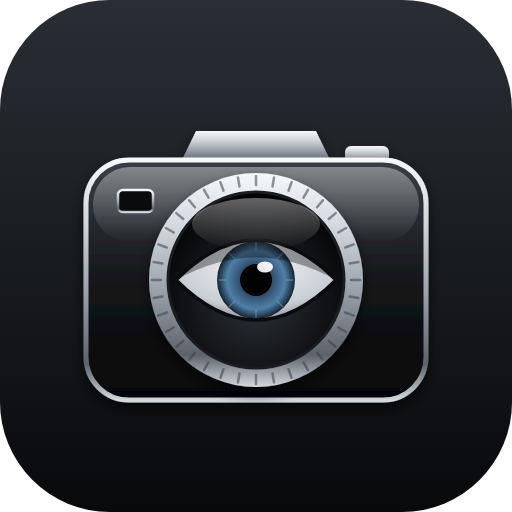

# ViewSmith v0.4

ViewSmith is a camera app that redraws what it sees by hand. Point it at something and the
screen shows it as a pencil sketch, an ink drawing, a comic panel, a watercolor, and more,
live, while you move. The lines can wobble a little from frame to frame, like hand-drawn
animation, so even a still scene feels alive.

I built it because I missed the old Paper Camera app and wanted something like it that I
could keep tweaking.

## How it works

Drag the silver ring on the dial to pick a mode, then tap the black glass button in the middle.

| Mode  | What the button does |
|-------|----------------------|
| PHOTO | Saves the drawing as a picture in **Pictures/ViewSmith** |
| VIDEO | Starts and stops recording the drawing, with sound, to **Movies/ViewSmith** |
| FILE  | Pick a photo or video from your gallery. Tap to save it drawn. Press and hold to pick a different one |

When you load a video in File mode, it loops on screen (silently) while you dial in the look.
Tap the button and ViewSmith saves a drawn copy of the whole clip, with its original sound,
to Movies/ViewSmith. The button turns red and the label counts up the percentage. Tap it again
to cancel. A long clip takes a while, since every single frame gets drawn.

Hold the phone upright and the drawing sits on top with the controls underneath. Turn it
sideways and the drawing fills the screen. The app doesn't actually rotate; the icons and
menus turn themselves to face you, so the camera never restarts in the middle of a shot.

### The side tabs

- **Style**: Pencil, Ink pen, Colored pencil, Comic, Halftone, Watercolor, Chalkboard.
  Also Mirror image, and Rotate camera 90° in case a camera ever shows up sideways.
- **Lines**: ink color, and how dark, how detailed, and how soft the outlines are
- **Shade**: how much shading, and how far apart the strokes are (or how big the dots are,
  for Comic and Halftone)
- **Paper**: how much paper grain shows through
- **Motion**: how much the lines wobble and how often they redraw. "Hold the video between
  redraws" freezes the picture between wobbles for a flipbook look. Hidden in Photo mode.

### The styles

- **Pencil**: graphite outlines and crosshatching that gets denser in the shadows
- **Ink pen**: the same strokes, but solid and crisp
- **Colored pencil**: strokes take on the colors of the picture
- **Comic**: flat bold colors, heavy outlines, and dots in the shadows
- **Halftone**: printed in cyan, magenta, yellow, and black dots, like an old newspaper photo
- **Watercolor**: soft washes that bleed a little past the edges, with paint pooling where
  a wash ends
- **Chalkboard**: white chalk on a green slate board

### Settings (the cog)

The gear in the bottom-left corner (it moves to stay in *your* bottom-left as you turn the phone):

- **Menu background**: 0% makes the menus clear glass so you can watch the drawing change
  as you adjust. 100% is solid.
- **Haptic clicks**, **Keep screen awake**, **Remember my look between launches**
- **Exit ViewSmith**

The back gesture closes an open menu first.

## What's new in v0.4

- New name and icon: PencilCam is now **ViewSmith**
- Videos in File mode: pick a clip, watch it drawn, save a drawn copy with sound
- Four new styles: Comic, Halftone, Watercolor, Chalkboard
- Saves now go to Pictures/ViewSmith and Movies/ViewSmith. Anything saved by older
  versions stays in the old PencilCam folders.

Earlier: v0.3 added the menus that turn with the phone and the Settings cog. v0.2 added the
dial, video recording, File mode for photos, and the side tabs.

**Coming next:** more styles, and a real release key so the app can be shared.

## Getting the APK

GitHub builds the app for me every time a change lands on `main`.

1. Open the repo on GitHub and go to the **Actions** tab.
2. Click the newest **Build APK** run with a green check.
3. Scroll to **Artifacts** and download **ViewSmith-apk**. Unzip it to get `app-debug.apk`.
4. Get that file onto the phone (download it on the phone, or copy it over USB) and tap it to install.

It installs right over the top of the old PencilCam and keeps your saved look. The name and icon
on the home screen change to ViewSmith.

### Installing on a Samsung phone

- Settings > Security and privacy > **Auto Blocker**: turn it off while testing.
- When asked, allow **Install unknown apps** for My Files or Chrome.
- If Play Protect warns about an unknown app, choose **Install anyway**.

## If something looks wrong

- **Camera picture sideways or upside down:** Style tab > **Rotate camera 90°** until it's right.
- **Selfie view backwards:** Style tab > **Mirror image**.
- **A saved video is sideways, or a video won't open:** note which clip and which phone it was
  recorded on. Different phones store video rotation differently.
- **A build failed (red X on the Actions tab):** open the failed run and click the failed step
  to see the error.

## About the signing key

`app/pencilcam-test.keystore` is a test key. Every build is signed with it so each one installs
as an update. That's why this repo has to stay private. Before the app is ever shared or sold,
it gets a real, secret release key.

The app's internal ID is still `com.pencilcam.app`. It never shows on screen, and changing it
would make Android treat ViewSmith as a different app. It'll switch to `com.viewsmith.app`
along with the release key.

## Project layout

| File | What it does |
|------|--------------|
| `MainActivity.kt` | The screen: dial, tabs, menus, camera, saving, File mode |
| `SketchRenderer.kt` | Runs the drawing on the graphics chip, for the screen, photos, and videos |
| `Shaders.kt` | The GPU programs that make each style |
| `SketchSettings.kt` | Every slider value, and saving them between launches |
| `VideoFile.kt` | File mode videos: playing them on screen and saving drawn copies |
| `VideoRecorder.kt` | Recording in Video mode |
| `ModeDial.kt` | The silver dial shutter |
| `Gloss.kt` | The black glass and silver look for every control |
| `design/` | The icon artwork |
